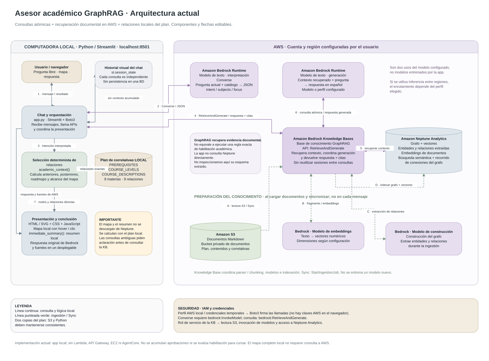

# Asesor académico GraphRAG

Demo en Python y Streamlit para consultar correlativas y ver sus relaciones.
Usa Amazon Bedrock Knowledge Bases con Amazon Neptune Analytics y documentos
Markdown en S3. Cada persona debe crear sus recursos y usar sus credenciales AWS.

## Cómo funciona

1. Bedrock interpreta la pregunta con `Converse`.
2. Python valida las materias y calcula el mapa y el resumen de correlativas.
3. `RetrieveAndGenerate` consulta la Knowledge Base GraphRAG para obtener una
   explicación respaldada por documentos, disponible junto con las fuentes.

El mapa visible viene de `PREREQUISITES` en `app.py`, **no se descarga de Neptune**.
Las preguntas son independientes: decir «aprobé» no registra aprobaciones ni
determina habilitación académica real. El diagrama editable está en
[`arquitectura-graphrag.drawio`](arquitectura-graphrag.drawio).

## Arquitectura



[Abrir el SVG en tamaño completo](arquitectura-graphrag.svg) ·
[Editar el diagrama en Draw.io](arquitectura-graphrag.drawio)

## 1. Crear los recursos en AWS

Usá tu propia cuenta y una región compatible con GraphRAG. Necesitás Python 3.10+ y AWS CLI v2.

### Bucket S3

- **Tipo:** propósito general.
- **Nombre:** uno único, elegido por vos.
- **Región:** la misma que la Knowledge Base.
- **Acceso:** privado; mantener el bloqueo de acceso público.
- **Resto:** valores predeterminados.
- Subí los archivos de `data/` a la raíz del bucket.

### Knowledge Base de Bedrock

En **Bedrock → Knowledge Bases**, crear una base con **vector store**:

- **Nombre:** el que prefieras.
- **Rol IAM:** crear un nuevo rol de servicio.
- **Origen:** Amazon S3 → seleccionar tu bucket.
- **Parser y chunking:** predeterminados.
- **Embeddings:** Titan Text Embeddings V2.
- **Vector store:** creación rápida → Neptune Analytics (GraphRAG).
- **Modelo de construcción del grafo:** uno compatible, por ejemplo Nova Micro.

Crear la KB, ejecutar **Sync** en el origen de datos y esperar a que termine.
Copiar su **ID** y el **ARN del modelo o perfil de inferencia** para la app.
Ese modelo debe admitir tanto `Converse` como `RetrieveAndGenerate`.

[Guía oficial de GraphRAG](https://docs.aws.amazon.com/bedrock/latest/userguide/knowledge-base-build-graphs-build.html).

## 2. Configurar y ejecutar

Desde la carpeta del proyecto:

```sh
python3 -m venv .venv
source .venv/bin/activate
python -m pip install -r requirements.txt
cp .env.example .env
```

Completar `.env` con tus datos:

```dotenv
AWS_REGION=TU_REGION
AWS_PROFILE=graphrag-demo
KNOWLEDGE_BASE_ID=TU_ID_DE_KB
MODEL_ARN=TU_ARN_DE_MODELO_O_PERFIL
```

Iniciar sesión con el mismo perfil y levantar la app:

```sh
aws login --profile graphrag-demo
python -m streamlit run app.py --server.address 127.0.0.1 --server.port 8501
```

Abrir [localhost:8501](http://localhost:8501).
Si usás IAM Identity Center, autenticar con `aws sso login --profile graphrag-demo`
después de configurar ese perfil con `aws configure sso`.

En Windows, activar con `.venv\Scripts\Activate.ps1` y copiar el ejemplo con
`Copy-Item .env.example .env`. En PyCharm, usar el intérprete de `.venv` y ejecutar
el módulo `streamlit` con los mismos parámetros, desde la carpeta del proyecto.

## 3. Modificar el contenido

1. Editar los `.md` de `data/`, manteniendo nombres y correlativas claros.
2. Subir los archivos actualizados a S3.
3. Ejecutar **Sync** en la Knowledge Base.

**Si cambia el plan**, actualizar también `COURSE_LEVELS`, `PREREQUISITES` y
`COURSE_DESCRIPTIONS` en `app.py`: los MD no modifican el mapa local automáticamente.
Si quitás o renombrás un documento, retirar el anterior de S3 antes de sincronizar.

## Probar

Preguntas de ejemplo: `Correlativas de IA Generativa`,
`Qué puedo hacer con Cloud` y `Dame un roadmap para Machine Learning`.

Pruebas locales sin consumo AWS:

```sh
python -m unittest discover -s tests -v
python tools/check_public_repo.py
```

El chequeo de publicación requiere Git. Para actualizar el SVG después de editar
el Draw.io: `python tools/export_architecture_svg.py`.

## Seguridad y costos

- No subir `.env` ni credenciales; compartir sólo `.env.example`.
- Ejecutar localmente y usar permisos IAM limitados a tus recursos.
- Cerrar la app **no detiene Neptune**. Detener el grafo desde AWS cuando no se use;
  antes de volver a consultar, iniciarlo y esperar a `AVAILABLE`.
- Neptune detenido sigue cobrando el **10 % de su tarifa normal**. S3 y las
  operaciones de Bedrock también pueden generar cargos.
- Borrar la KB **no elimina el grafo**.

[Cómo detener Neptune](https://docs.aws.amazon.com/neptune-analytics/latest/userguide/managing-stopping.html).
